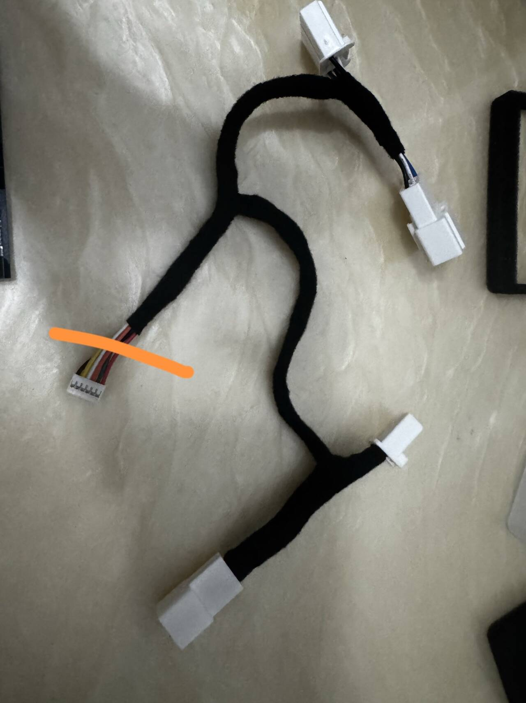
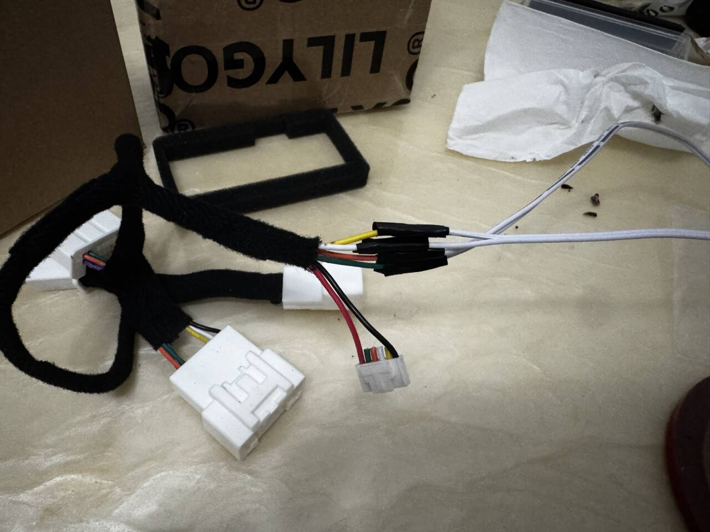
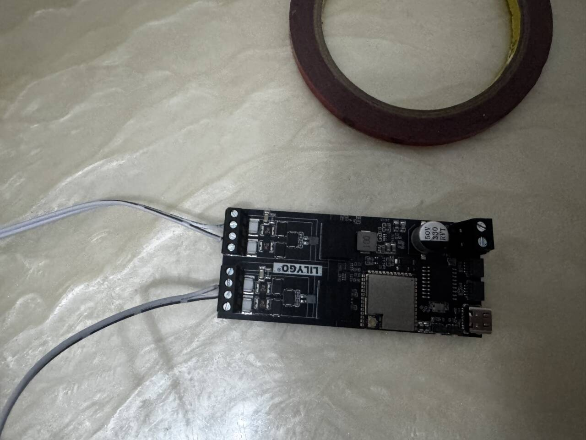
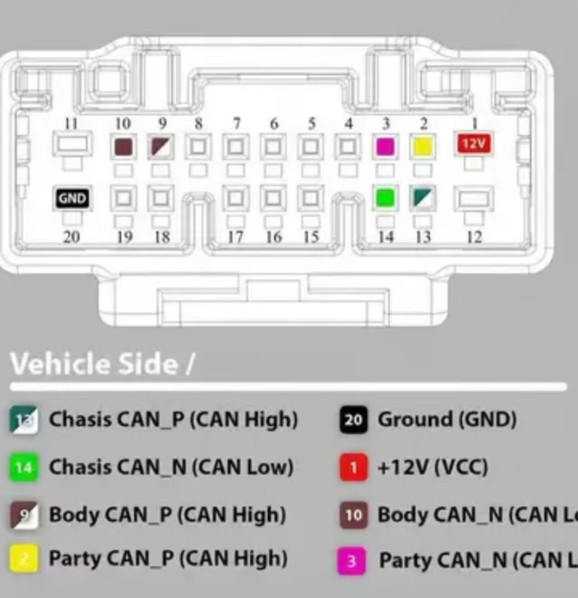

# T-2CAN 打灯自动变道精简版

## 硬件购买

### 1. T-2CAN 开发板

本固件需要 **LILYGO T-2CAN ESP32-S3 普通版**（MCP2515），购买时注意区分 CAN FD 版本。

> **重要提示：本接线方案下，下单时必须联系卖家客服，要求拆掉 T-2CAN 开发板上的 120 欧姆电阻。**

- 参考到手价：**168.91 元**
- [淘宝下单链接](https://m.tb.cn/h.jjwbm4Z)

### 2. 线束

线束可以按自己的动手需求选择：

**TITA 家线束**：约 **60 元**，需要另外接延长线。

**成品延长线束**：约 **150 元**，想少折腾可以选成品。

下单前请向商家确认车型、接口和线束规格。以上价格仅供参考，实际以商家报价为准；店铺截图中不同商品的价格以对应商品页面为准。

## HW4 车型：TITA 线束接线参考

以下记录的是提供的 HW4 TITA 线束示例；线色、插头和针脚可能因车型、年款或线束版本不同而变化，动手前请与卖家核对实际线束，不能只凭颜色判断。

> **请先断电并将线束与车辆和开发板断开，再进行剪线与接线。** 当前固件会在 CAN A 上主动发送帧，接线、车辆兼容性和功能效果尚未完成台架或实车验证，请先在隔离 CAN 台架验证，不要用于道路行驶。

### 1. 处理线束插头

按下图橙色标记的位置，剪掉 TITA 转接线束支线末端的小插头，预留足够长度接延长线；不要剪断车辆原车线束。剪线前确认标记位置和各根线的用途；未使用的线芯分别做好绝缘，避免短路。

### 2. 接延长线并连接 T-2CAN

按下面的线色对应关系接线，CAN H 接 H、CAN L 接 L。接头应牢固并分别绝缘；T-2CAN 端以板上 CAN A、CAN B 及 H/L 实际标识为准。

| TITA 线束线色 | 用户提供的信号 | T-2CAN 端口 |
| --- | --- | --- |
| 橙色 | Chassis CAN H | CAN A 的 H |
| 绿色 | Chassis CAN L | CAN A 的 L |
| 黄色 | CAN H | CAN B 的 H |
| 白色 | CAN L | CAN B 的 L |

线束接延长线的参考照片：

T-2CAN 接线参考照片：

**固件说明：** 当前精简版只初始化并使用 CAN A；黄色和白色线即使按上表接到 CAN B，当前固件也不会使用 CAN B。

### 3. 插头针脚参考图

下面的图是所提供的车辆侧插头参考，仅用于核对资料；图中颜色和编号不能直接替代对具体车型、线束与插头朝向的核实。

