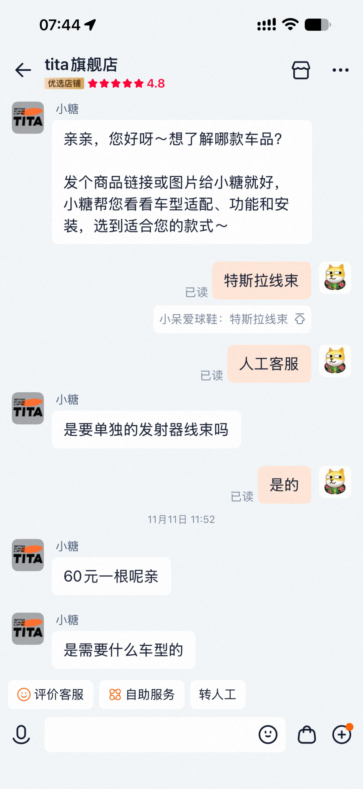

# T-2CAN 打灯自动变道精简版

## 硬件购买

### 1. T-2CAN 开发板

本固件需要 **LILYGO T-2CAN ESP32-S3 普通版**（MCP2515），购买时注意区分 CAN FD 版本。

> **重要提示：下单时必须联系卖家客服，要求拆掉 T-2CAN 开发板上的 120 欧姆电阻。**

- 参考到手价：**168.91 元**
- [淘宝下单链接](https://m.tb.cn/h.jjwbm4Z)

### 2. 线束

线束可以按自己的动手需求选择：

**TITA 家线束**：约 **60 元**，需要另外接延长线。

**成品延长线束**：约 **150 元**，想少折腾可以选成品。

下单前请向商家确认车型、接口和线束规格。以上价格仅供参考，实际以商家报价为准；店铺截图中不同商品的价格以对应商品页面为准。
